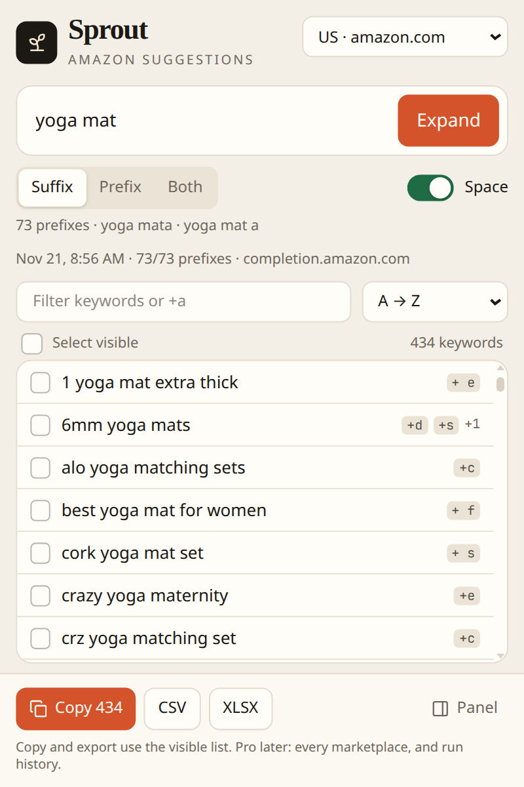

# Sprout — Amazon Suggestion Expander

Sprout turns one seed keyword into the autocomplete list Amazon shoppers see, then walks every letter and digit so sellers, KDP authors, and Merch designers can collect long-tail variations in one pass.

The working name was Amazon Suggestion Expander. The extension is **Sprout**. The Chrome Web Store title keeps both: “Sprout — Amazon Suggestion Expander”.

It does not estimate search volume, and it does not ask for an Amazon account.

## English

### Requirements

- Node.js 20 or newer
- Brave or Chrome (Chromium 120+)

### Build

```bash
npm install
npm run build
```

`npm run build` typechecks, then writes a Manifest V3 extension to `dist/`. Load that folder unpacked.

```bash
npm test
npm run verify:live
```

`npm test` covers query building, deduping, response parsing, fallback, CSV/XLSX, and the Pro gate. `npm run verify:live` calls Amazon’s completion API for `yoga mat` on amazon.com and amazon.de and fails if the payload is not real suggestion JSON.

A zip of the built folder is produced with:

```bash
npm run package
```

Unzip `release/amazon-suggestion-expander-dist.zip` and load the `amazon-suggestion-expander` folder.

### Load unpacked on macOS

Brave:

1. Open `brave://extensions`.
2. Turn on **Developer mode** (Režim pre vývojárov).
3. Click **Load unpacked** (Načítať rozbalené).
4. Choose the `dist` folder from this project.
5. Pin Sprout from the puzzle-piece menu.

Chrome is the same flow at `chrome://extensions`.

### Using it

- **Popup.** Click the toolbar icon. Type a seed, pick a marketplace, press Expand.
- **Side panel.** Click **Panel** in the popup, or open Brave’s side panel and choose Sprout. The run keeps going if you switch tabs. The popup closes when you leave it, so use the side panel for a long pass.
- **On an Amazon search page.** A pill sits at the bottom-right. It reads the current search (`k` or `field-keywords` in the URL, otherwise the search box). Click it to expand that term on the matching marketplace.

Default pass: the seed, then the seed with each `a–z` and `0–9` glued on (`yoga mata`), and the same letters after a space (`yoga mat a`). Prefix mode does `ayoga mat` and `a yoga mat`. Both runs every form. Turn **Space** off to cut the request count roughly in half.

Results are deduped. Each row shows which expansions produced it (`seed`, `+a`, `+ a`). Filter, sort, select, then copy as newline-separated keywords, or download CSV or XLSX. The last seed, marketplace, options, and result list are stored in `chrome.storage.local`.

Requests go out three at a time, with a short gap, and retry on rate limits and 5xx responses with backoff. If `completion.amazon.<domain>` fails or returns a body that is not suggestion JSON, Sprout retries that prefix on `www.amazon.<domain>/suggestions` and says so in the panel. An empty list for an obscure prefix is a normal answer, not an error. If the seed itself fails on both hosts, the panel names both hosts and the HTTP status instead of showing a blank success.

### Where the endpoint lives

Marketplace ids, domains, and locales are in `src/lib/marketplaces.ts`. URL shapes are in `src/lib/endpoints.ts`.

Checked on 21 Nov 2026:

| Marketplace | Seed | Endpoint | Sample |
| --- | --- | --- | --- |
| amazon.com | yoga mat | `completion.amazon.com/api/2017/suggestions` | yoga mat thick, yoga mat towel, yoga mat strap |
| amazon.de | yoga mat | `completion.amazon.de/api/2017/suggestions` | yoga matte, yoga matte dick, yoga matte kork |
| amazon.de | yogamatte | same | yogamatte rutschfest, yogamatte dick |
| amazon.com | yoga mat a | same | yoga mat and towel set, yoga mat amazon basics |

A full US suffix + space run of `yoga mat` that day finished 73/73 prefixes with 434 unique keywords and no failures, using `completion.amazon.com`. `completion.amazon.in` often returns HTTP 502; Sprout then uses `www.amazon.in/suggestions`, which did return keywords. The old `/search/complete` route is a 404.

### Pro, later

`src/lib/pro.ts` exports `CURRENT_ENTITLEMENTS`. Both flags are `false` in this build. `expandAllMarketplaces` and `appendHistory` already exist and refuse to run until a license check flips the matching flag. The department `alias` argument on `suggestionUrl` defaults to `aps` (all departments) so a later Books or Clothing pass does not need a new client.

## Slovenčina

Sprout z jedného seed kľúčového slova spraví zoznam, ktorý Amazon ukazuje v našeptávači, a potom ho rozšíri o každé písmeno a číslicu. Je to nástroj na prieskum kľúčových slov pre predajcov, autorov KDP a tvorcov Merch. Neodhaduje objem vyhľadávania a nepýta si účet na Amazone.

Pracovný názov bol Amazon Suggestion Expander. Rozšírenie sa volá **Sprout**. V názve pre Chrome Web Store ostávajú obe časti.

### Čo treba

- Node.js 20 alebo novší
- Brave alebo Chrome (Chromium 120+)

### Zostavenie

```bash
npm install
npm run build
```

Tento príkaz skontroluje typy a zapíše rozšírenie Manifest V3 do priečinka `dist/`. Ten sa nahráva ako rozbalené rozšírenie.

```bash
npm test
npm run verify:live
```

`npm test` kryje skladanie dopytov, deduplikáciu, parsovanie odpovede, záložný endpoint, CSV/XLSX a Pro prepínač. `npm run verify:live` zavolá completion API pre `yoga mat` na amazon.com a amazon.de a skončí chybou, ak odpoveď nie je JSON s návrhmi.

Zip hotového priečinka:

```bash
npm run package
```

Rozbaľ `release/amazon-suggestion-expander-dist.zip` a načítaj priečinok `amazon-suggestion-expander`.

### Načítanie v Brave na macOS

1. Otvor `brave://extensions`.
2. Zapni **Režim pre vývojárov** (Developer mode).
3. Klikni **Načítať rozbalené** (Load unpacked).
4. Vyber priečinok `dist`.
5. Pripni Sprout z ponuky skladačky.

V Chrome je postup rovnaký na `chrome://extensions`.

### Ako sa používa

- **Popup.** Klikni na ikonu v paneli. Napíš seed, vyber trhovisko, stlač Expand.
- **Bočný panel.** V popupe klikni **Panel**, alebo v Brave otvor bočný panel a vyber Sprout. Beh pokračuje, aj keď prepneš kartu. Popup sa zatvorí, keď z neho odídeš, preto dlhší beh nechaj v bočnom paneli.
- **Na stránke vyhľadávania Amazonu.** Vpravo dole je malá kapsula. Prečíta aktuálny výraz (`k` alebo `field-keywords` v URL, inak text vo vyhľadávacom poli). Kliknutím sa výraz rozšíri na trhovisku podľa domény.

Predvolený beh: samotný seed, potom seed s prilepeným `a–z` a `0–9` (`yoga mata`) a tie isté znaky za medzerou (`yoga mat a`). Režim Prefix robí `ayoga mat` a `a yoga mat`. Both spustí všetky tvary. Vypnutím **Space** zhruba o polovicu klesne počet požiadaviek.

Výsledky sú bez duplicít. Pri každom riadku je vidno, ktoré rozšírenie ho prinieslo (`seed`, `+a`, `+ a`). Dá sa filtrovať, triediť, označiť a skopírovať ako kľúčové slová oddelené novým riadkom, alebo stiahnuť CSV a XLSX. Posledný seed, trhovisko, voľby a zoznam ostanú v `chrome.storage.local`.

Požiadavky idú po troch, s krátkou medzerou, a pri obmedzení rýchlosti alebo odpovedi 5xx sa opakujú s odstupom. Keď `completion.amazon.<doména>` zlyhá alebo nevráti JSON návrhov, Sprout ten istý prefix skúsi na `www.amazon.<doména>/suggestions` a v paneli to napíše. Prázdny zoznam pri nezvyčajnom prefixe je normálna odpoveď, nie chyba. Ak zlyhá aj samotný seed na oboch hostiteľoch, panel uvedie oba hostiteľov a HTTP stav namiesto prázdneho úspechu.

### Kde je endpoint

Identifikátory trhovísk, domény a locale sú v `src/lib/marketplaces.ts`. Tvar URL je v `src/lib/endpoints.ts`.

Overené 21. novembra 2026: `yoga mat` na amazon.com vrátilo napríklad yoga mat thick a yoga mat towel; na amazon.de `yoga matte`, `yoga matte dick`, `yogamatte rutschfest`. Úplný beh suffix + medzera pre `yoga mat` na .com v ten deň dokončil 73/73 prefixov, 434 unikátnych slov, bez zlyhania, cez `completion.amazon.com`. `completion.amazon.in` často vracia HTTP 502; Sprout potom použije `www.amazon.in/suggestions`. Stará cesta `/search/complete` vracia 404.

### Pro, neskôr

`src/lib/pro.ts` má `CURRENT_ENTITLEMENTS`. V tomto zostavení sú oba prepínače `false`. `expandAllMarketplaces` a `appendHistory` už existujú a odmietnu bežať, kým kontrola licencie príslušný prepínač nezapne. Argument `alias` vo `suggestionUrl` je predvolene `aps` (všetky oddelenia), takže neskorší beh pre knihy alebo oblečenie nepotrebuje nového klienta.

Súkromie: [PRIVACY.md](PRIVACY.md). Návrh textu do Chrome Web Store: [STORE_LISTING.md](STORE_LISTING.md).


