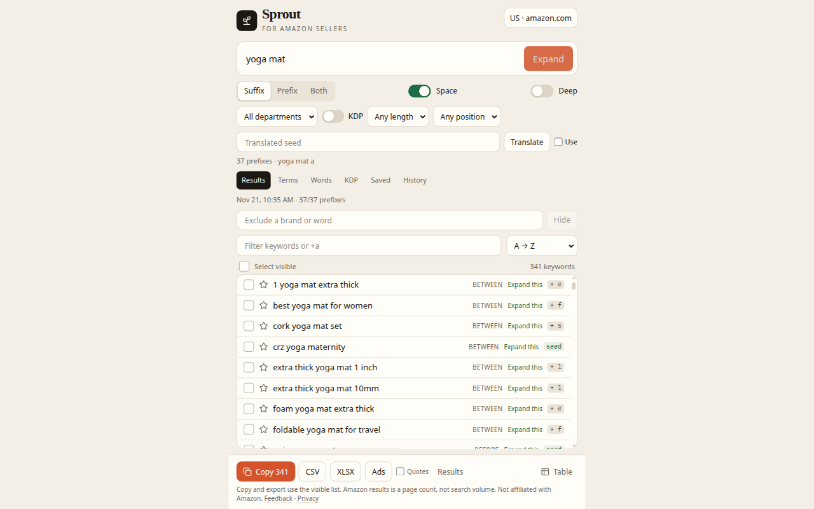
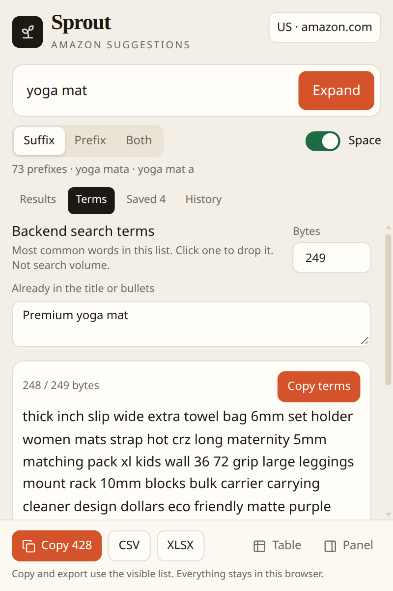
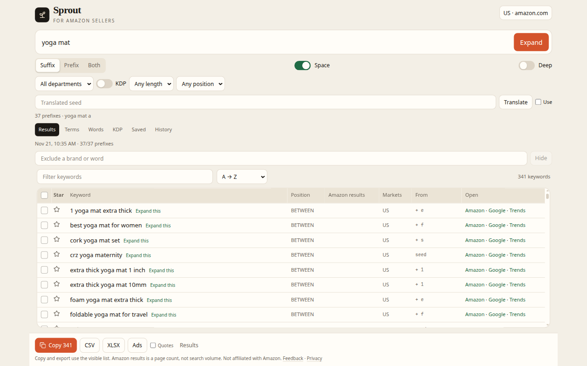
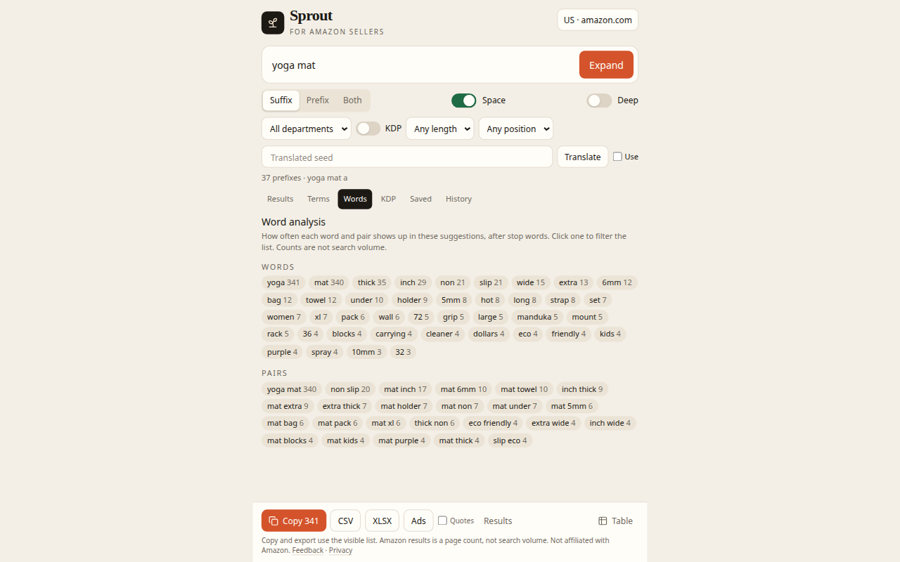
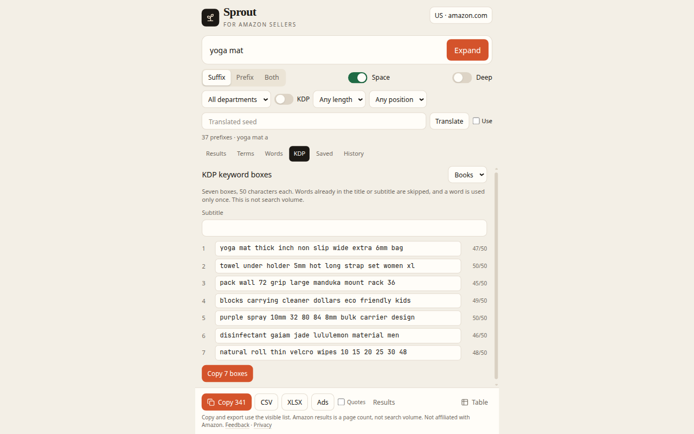
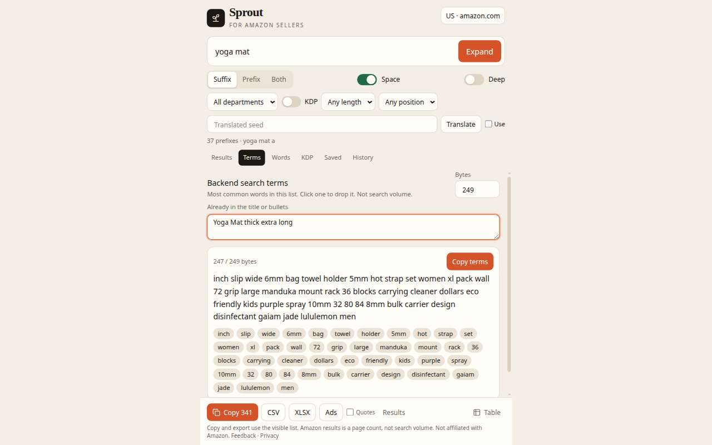
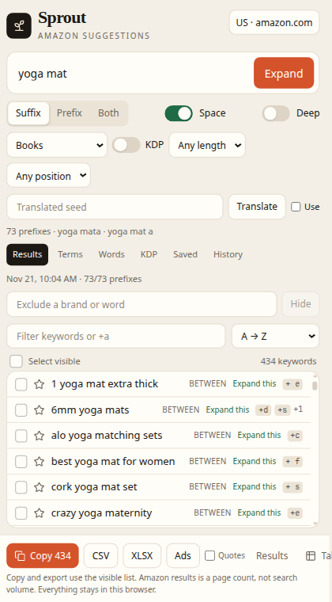
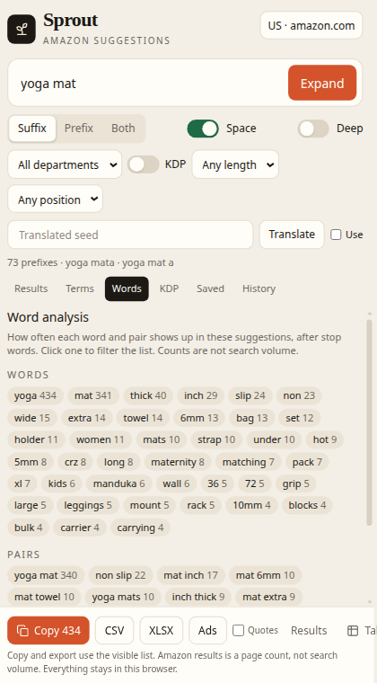
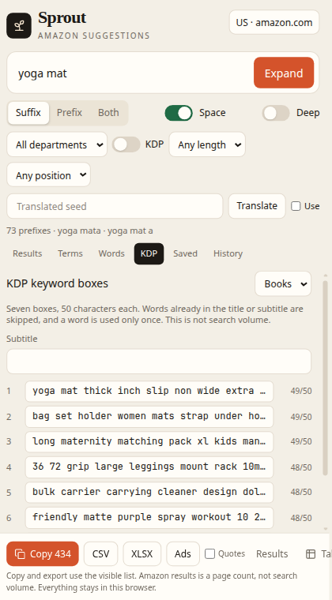
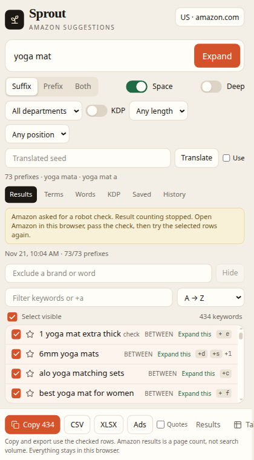

# Sprout

Sprout is a free Chrome and Brave extension for Amazon keyword research. One seed becomes the autocomplete list shoppers see, then every letter and digit. It is for sellers, KDP authors, and Merch designers.

Sprout is not affiliated with Amazon. Amazon is a trademark of Amazon.com, Inc. There is no account, no tracking, and no invented search volume, CPC, or sales.

Source and feedback: https://github.com/busfyroman/sprout
Privacy policy: https://busfyroman.github.io/sprout/privacy.html

## Install

From the Chrome Web Store, after the listing is published: search for **Sprout – Amazon Keyword Research for Sellers**. The package is free.

Unpacked, from a git checkout:

```bash
npm install
npm run build
```

Load `dist/` at `chrome://extensions` or `brave://extensions` with Developer mode on. Choose **Load unpacked**. Pin Sprout from the puzzle-piece menu. The same steps in Slovak are below.

A store upload zip, with `manifest.json` at the root of the archive, is `npm run package:cws`.



## English

### Requirements

- Node.js 20 or newer
- Brave or Chrome (Chromium 120+)

### Build

```bash
npm install
npm run build
```

`npm run build` typechecks, then writes a Manifest V3 extension to `dist/`. Load that folder unpacked.

```bash
npm test
npm run verify:live
```

`npm test` covers query building, deduping, response parsing, fallback, CSV/XLSX, the feature flags, and a regression that calls `fetch` the way Chrome does (so a detached `fetch` cannot ship again). `npm run verify:live` calls Amazon’s completion API for `yoga mat` on amazon.com and amazon.de. `npm run test:browser` loads the built extension in Playwright’s Chromium and runs the panel, including a real expand.

A zip of the built folder is produced with:

```bash
npm run package
```

Unzip `release/amazon-suggestion-expander-dist.zip` and load the `amazon-suggestion-expander` folder.

### Load unpacked on macOS

Brave:

1. Open `brave://extensions`.
2. Turn on **Developer mode** (Režim pre vývojárov).
3. Click **Load unpacked** (Načítať rozbalené).
4. Choose the `dist` folder from this project.
5. Pin Sprout from the puzzle-piece menu.

Chrome is the same flow at `chrome://extensions`.

### Using it

- **Popup.** Click the toolbar icon. Type a seed, pick a marketplace, press Expand.
- **Side panel.** Click **Panel** in the popup, or open Brave’s side panel and choose Sprout. The run keeps going if you switch tabs. The popup closes when you leave it, so use the side panel for a long pass.
- **On an Amazon search page.** A pill sits at the bottom-right. It reads the current search (`k` or `field-keywords` in the URL, otherwise the search box). Click it to expand that term on the matching marketplace.

Default pass, with **Space** on: the seed, then `yoga mat a` through `yoga mat z` and the digits. **Space** off asks for the joined form instead (`yoga mata`). It does not ask for both. Prefix mode does `a yoga mat` or `ayoga mat`. Both runs the suffix and the prefix.

Results are deduped. Each row shows which expansions produced it (`seed`, `+a`, `+ a`), whether the seed sits before, after, or between the other words, and a “similar” mark when a neighbor looks like a typo. Filter, sort, star, select, then copy as newline-separated keywords, or download CSV, XLSX (a second sheet is Word analysis), or an Amazon Ads bulk-sheet CSV (`Campaign`, `Ad Group`, `Keyword`, `Match Type`). The last seed, marketplace, options, result list, stars, and the last 20 runs are stored in `chrome.storage.local` on this device. There is no Sprout account and no Sprout server.

### Search terms, exclusions, stars, batch, history

- **Backend search terms.** The Terms tab builds a space-separated string from the most common words in the current results, within a byte limit (249 by default, editable). It skips stop words, words you paste from the title or bullets, and words you have excluded. Click a word to drop it; the next word fills the freed bytes. A counter shows UTF-8 bytes used. This is frequency in the suggestion list, not search volume.
- **Exclude words.** A brand or phrase you add is hidden from the list and from copy/CSV/XLSX. The list is kept locally.
- **Saved keywords.** The star keeps a keyword with its marketplace and the date. The Saved tab copies or exports that list.
- **Several marketplaces.** Open the marketplace button and check more than one. One Expand runs the same seed on each, and rows are tagged with the marketplace codes.
- **History.** The last 20 finished runs can be reopened and exported again.
- **Keyword table.** Table (or the extension’s options page) opens a full page: sort, filter, and a link from each row to that keyword on Amazon, Google, and Google Trends. Sprout does not invent search volume or CPC.

### Departments, depth, words, KDP, and counts (0.3.0)

- **Department.** The picker sends Amazon’s search alias (`aps`, `stripbooks` for Books, `digital-text` for Kindle, Fashion, Electronics, and the rest of the list). On an Amazon page, the first open uses `#searchDropdownBox` when you have not chosen a department yet.
- **Deep.** Adds connector words (`for`, `with`, `and`, `without`, `vs`, `under`, or the local equivalents) and a letter after each. **Expand this** on a row starts a new run from that phrase, at most two steps past the original seed. Stop still cancels the queue.
- **Words.** Unigram and bigram counts with stop words removed. Click a word to filter the list. The same table is the second XLSX sheet. Counts are how often the word appears in these suggestions.
- **Position and length.** Filter to before / after / between / other, and to 1 word, 2 words, or 3+ words.
- **KDP.** Forces Books or Kindle, then fills seven boxes of 50 characters. Words from the title and subtitle are skipped, and a word is not reused across boxes.
- **Amazon results.** Counts search-page results for checked rows, or starred rows if none are checked, about one page per second. Optional quotes ask for an exact phrase. The label says result count, not search volume. A robot check stops the queue and tells you.
- **Page terms.** On a search page, related searches are chips you can use as a seed. **One more level** reads up to three of those pages. On a product page, **Use title as seed** copies the title. Store names are exclude chips; nothing is hidden until you click.
- **Translate.** **Translate** tries Chrome’s on-device Translator. If that API is missing, type the local seed yourself. **Use** expands the translated field on the marketplace you picked, and the original stays in the seed box.

`completion.amazon.in` still answers HTTP 502. Sprout uses `www.amazon.in/suggestions` for India. The other listed marketplaces returned suggestion JSON from `completion.<domain>` on 21 Nov 2026, including Japan, Brazil, Turkey, Ireland, Egypt, and Saudi Arabia. Electronics on amazon.com returned a short list; the JSON was valid.

Requests go out three at a time, with a short gap, and retry on rate limits and 5xx responses with backoff. If `completion.amazon.<domain>` fails or returns a body that is not suggestion JSON, Sprout retries that prefix on `www.amazon.<domain>/suggestions` and says so in the panel. An empty list for an obscure prefix is a normal answer, not an error. If the seed itself fails on both hosts, the panel names both hosts and the HTTP status instead of showing a blank success.

### Where the endpoint lives

Marketplace ids, domains, and locales are in `src/lib/marketplaces.ts`. URL shapes are in `src/lib/endpoints.ts`.

Checked on 21 Nov 2026:

| Marketplace | Seed | Endpoint | Sample |
| --- | --- | --- | --- |
| amazon.com | yoga mat | `completion.amazon.com/api/2017/suggestions` | yoga mat thick, yoga mat towel, yoga mat strap |
| amazon.de | yoga mat | `completion.amazon.de/api/2017/suggestions` | yoga matte, yoga matte dick, yoga matte kork |
| amazon.de | yogamatte | same | yogamatte rutschfest, yogamatte dick |
| amazon.com | yoga mat a | same | yoga mat and towel set, yoga mat amazon basics |

A full US suffix + space run of `yoga mat` that day finished 73/73 prefixes with 434 unique keywords and no failures, using `completion.amazon.com`. `completion.amazon.in` often returns HTTP 502; Sprout then uses `www.amazon.in/suggestions`, which did return keywords. The old `/search/complete` route is a 404.

### Feature flags

`src/lib/pro.ts` exports `CURRENT_ENTITLEMENTS`. Every flag is on: multi-marketplace, history, search terms, saved keywords, and exclusions. There is no license check. Set a flag to `false` later if a build should hide that feature; callers already use `hasPro`. Department scope is the `alias` argument on `suggestionUrl` (`aps` by default, or `stripbooks`, `digital-text`, and the other aliases in `src/lib/departments.ts`).

## Slovenčina

Sprout z jedného seed kľúčového slova spraví zoznam, ktorý Amazon ukazuje v našeptávači, a potom ho rozšíri o každé písmeno a číslicu. Je to nástroj na prieskum kľúčových slov pre predajcov, autorov KDP a tvorcov Merch. Neodhaduje objem vyhľadávania a nepýta si účet na Amazone.

V Chrome Web Store sa volá **Sprout – Amazon Keyword Research for Sellers**. Nie je prepojené s Amazonom. Zdroj: https://github.com/busfyroman/sprout. Súkromie: https://busfyroman.github.io/sprout/privacy.html.

### Čo treba

- Node.js 20 alebo novší
- Brave alebo Chrome (Chromium 120+)

### Zostavenie

```bash
npm install
npm run build
```

Tento príkaz skontroluje typy a zapíše rozšírenie Manifest V3 do priečinka `dist/`. Ten sa nahráva ako rozbalené rozšírenie.

```bash
npm test
npm run verify:live
```

`npm test` kryje skladanie dopytov, deduplikáciu, parsovanie odpovede, záložný endpoint, CSV/XLSX a Pro prepínač. `npm run verify:live` zavolá completion API pre `yoga mat` na amazon.com a amazon.de a skončí chybou, ak odpoveď nie je JSON s návrhmi.

Zip hotového priečinka:

```bash
npm run package
```

Rozbaľ `release/amazon-suggestion-expander-dist.zip` a načítaj priečinok `amazon-suggestion-expander`.

### Načítanie v Brave na macOS

1. Otvor `brave://extensions`.
2. Zapni **Režim pre vývojárov** (Developer mode).
3. Klikni **Načítať rozbalené** (Load unpacked).
4. Vyber priečinok `dist`.
5. Pripni Sprout z ponuky skladačky.

V Chrome je postup rovnaký na `chrome://extensions`.

### Ako sa používa

- **Popup.** Klikni na ikonu v paneli. Napíš seed, vyber trhovisko, stlač Expand.
- **Bočný panel.** V popupe klikni **Panel**, alebo v Brave otvor bočný panel a vyber Sprout. Beh pokračuje, aj keď prepneš kartu. Popup sa zatvorí, keď z neho odídeš, preto dlhší beh nechaj v bočnom paneli.
- **Na stránke vyhľadávania Amazonu.** Vpravo dole je malá kapsula. Prečíta aktuálny výraz (`k` alebo `field-keywords` v URL, inak text vo vyhľadávacom poli). Kliknutím sa výraz rozšíri na trhovisku podľa domény.

Predvolený beh so zapnutým **Space**: seed, potom `yoga mat a` až `yoga mat z` a číslice. Vypnuté **Space** pýta spojený tvar (`yoga mata`), nie oba naraz. Prefix robí `a yoga mat` alebo `ayoga mat`. Both spustí príponu aj predponu.

Výsledky sú bez duplicít. Pri každom riadku je vidno, ktoré rozšírenie ho prinieslo (`seed`, `+a`, `+ a`), či seed stojí pred, za alebo medzi ostatnými slovami, a značku „similar“, keď sused vyzerá ako preklep. Dá sa filtrovať, triediť, označiť hviezdičkou a skopírovať ako kľúčové slová oddelené novým riadkom, alebo stiahnuť CSV, XLSX (druhý hárok je Word analysis) a CSV pre Amazon Ads (`Campaign`, `Ad Group`, `Keyword`, `Match Type`). Posledný seed, trhovisko, voľby, zoznam, hviezdičky a posledných 20 behov ostanú v `chrome.storage.local` v tomto prehliadači. Sprout nemá účet ani vlastný server.

### Search terms, vylúčenia, hviezdičky, viac trhovísk, história

- **Backend search terms.** Karta Terms poskladá reťazec z najčastejších slov vo výsledkoch, v limite bajtov (predvolene 249, dá sa zmeniť). Vynechá stop slová, slová vložené z titulku alebo odrážok a vylúčené slová. Klik na slovo ho vyhodí a na uvoľnené bajty príde ďalšie. Počítadlo ukazuje UTF-8 bajty. Je to počet výskytov v návrhoch, nie objem vyhľadávania.
- **Vylúčené slová.** Značka alebo slovné spojenie zmizne zo zoznamu aj z kopírovania a exportu. Zoznam ostáva lokálne.
- **Uložené kľúčové slová.** Hviezdička podrží slovo s trhoviskom a dátumom. Karta Saved ho skopíruje alebo exportuje.
- **Viac trhovísk.** Otvor tlačidlo trhoviska a zaškrtni viac ako jedno. Jeden Expand spustí ten istý seed na každom a riadky označí kódom trhoviska.
- **História.** Posledných 20 dokončených behov sa dá znova otvoriť a exportovať.
- **Tabuľka.** Table (alebo stránka možností rozšírenia) otvorí celú stránku: triedenie, filter a odkaz z každého riadku na Amazon, Google a Google Trends. Sprout nevymýšľa hľadanosť ani CPC.

### Oddelenia, hĺbka, slová, KDP a počty (0.3.0)

- **Oddelenie.** Výber posiela Amazon alias (`aps`, `stripbooks` pre knihy, `digital-text` pre Kindle, móda, elektronika a ďalšie). Na stránke Amazonu sa pri prvom otvorení použije `#searchDropdownBox`, kým oddelenie nezmeníte.
- **Deep.** Pridá spojky (`for`, `with`, `and`, `without`, `vs`, `under` alebo miestne tvary) a písmeno za každou. **Expand this** na riadku spustí nový beh z toho slovného spojenia, najviac dva kroky od pôvodného seedu. Stop rad zruší.
- **Words.** Počty slov a dvojíc bez stop slov. Klik na slovo filtruje zoznam. Tá istá tabuľka je druhý hárok XLSX. Počet je výskyt v týchto návrhoch.
- **Pozícia a dĺžka.** Filter before / after / between / other a 1 slovo, 2 slová alebo 3+ slov.
- **KDP.** Vynúti Books alebo Kindle a naplní sedem polí po 50 znakoch. Slová z titulku a podtitulku vynechá a slovo sa v poliach neopakuje.
- **Amazon results.** Spočíta výsledky vyhľadávacej stránky pre zaškrtnuté riadky, alebo pre hviezdičky, keď nie je nič zaškrtnuté, zhruba jedna stránka za sekundu. Úvodzovky pýtajú presnú frázu. Štítok hovorí počet výsledkov, nie objem hľadania. Kontrola robota rad zastaví a napíše prečo.
- **Výrazy zo stránky.** Na vyhľadávaní sú súvisiace hľadania čipy, ktoré viete použiť ako seed. **One more level** prečíta najviac tri z tých stránok. Na produkte **Use title as seed** vezme titulok. Názvy obchodov sú čipy na vylúčenie; nič sa neskryje, kým nekliknete.
- **Preklad.** **Translate** skúsi prekladač v Chrome, ktorý beží v zariadení. Keď API nie je, lokálny seed napíšte sami. **Use** rozšíri preložené pole na zvolenom trhovisku a pôvodný text ostane v poli seed.

`completion.amazon.in` stále vracia HTTP 502. Pre Indiu Sprout použije `www.amazon.in/suggestions`. Ostatné uvedené trhoviská 21. novembra 2026 vrátili JSON návrhov z `completion.<doména>`, vrátane Japonska, Brazílie, Turecka, Írska, Egypta a Saudskej Arábie. Elektronika na amazon.com vrátila krátky zoznam; JSON bol platný.

Požiadavky idú po troch, s krátkou medzerou, a pri obmedzení rýchlosti alebo odpovedi 5xx sa opakujú s odstupom. Keď `completion.amazon.<doména>` zlyhá alebo nevráti JSON návrhov, Sprout ten istý prefix skúsi na `www.amazon.<doména>/suggestions` a v paneli to napíše. Prázdny zoznam pri nezvyčajnom prefixe je normálna odpoveď, nie chyba. Ak zlyhá aj samotný seed na oboch hostiteľoch, panel uvedie oba hostiteľov a HTTP stav namiesto prázdneho úspechu.

### Kde je endpoint

Identifikátory trhovísk, domény a locale sú v `src/lib/marketplaces.ts`. Tvar URL je v `src/lib/endpoints.ts`.

Overené 21. novembra 2026: `yoga mat` na amazon.com vrátilo napríklad yoga mat thick a yoga mat towel; na amazon.de `yoga matte`, `yoga matte dick`, `yogamatte rutschfest`. Úplný beh suffix + medzera pre `yoga mat` na .com v ten deň dokončil 73/73 prefixov, 434 unikátnych slov, bez zlyhania, cez `completion.amazon.com`. `completion.amazon.in` často vracia HTTP 502; Sprout potom použije `www.amazon.in/suggestions`. Stará cesta `/search/complete` vracia 404.

### Prepínače funkcií

`src/lib/pro.ts` má `CURRENT_ENTITLEMENTS`. Všetky prepínače sú zapnuté: viac trhovísk, história, search terms, uložené slová a vylúčenia. Licencia sa nekontroluje. Prepínač nastavený na `false` funkciu neskôr skryje; volania už používajú `hasPro`. Argument `alias` vo `suggestionUrl` je predvolene `aps` (všetky oddelenia).

Súkromie: [PRIVACY.md](PRIVACY.md). Návrh textu do Chrome Web Store: [STORE_LISTING.md](STORE_LISTING.md).



















